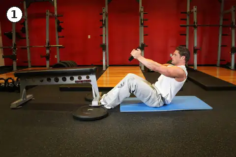

# Russian Twist

> Oberkörper zurückgelehnt, Rücken lang, Hantel von Hüfte zu Hüfte. Füße am Boden ist leichter.

- **Muskeln/Bereich:** Core (Rotation)
- **Equipment:** Kurzhanteln
- **Kategorie:** Core
- **Erfassung:** Körpergewicht, Wiederholungen

## Kommt vor in

- [Vorlage Core-Zirkel 20 min](../ablaeufe/vorlagen/x-core3.md)
