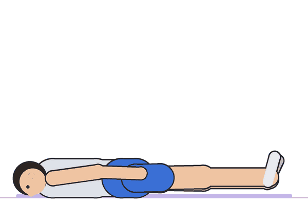

# Endentspannung

> Auf dem Rücken liegen, alles loslassen, Atem kommen und gehen lassen.

- **Muskeln/Bereich:** Entspannung
- **Equipment:** Körpergewicht
- **Kategorie:** Mobility
- **Erfassung:** Sekunden (Halten)

## Ausführung

- Auf dem Rücken, Beine etwas breiter als die Hüfte, Füße fallen locker nach außen.
- Arme etwas vom Körper weg, Handflächen nach oben.
- Kinn leicht zur Brust, Nacken lang. Bei Bedarf Kissen unter die Knie.
- Augen schließen, Gesicht weich, Kiefer lösen.

## Häufige Fehler

- Gedanklich schon beim nächsten Termin sein: den Atem einfach beobachten.

## Atmung

Nichts steuern. Atem kommen und gehen lassen.

## Wo du es spürst

Schwere, Wärme, ruhiger Puls.

## Kommt vor in

- [Yoga-Flow · 20 min](../ablaeufe/gefuehrt/yoga20.md)
- [Yoga · 30 min](../ablaeufe/gefuehrt/yoga30.md)
