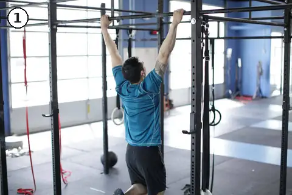

# Schulterblatt-Klimmzüge

> Mit gestreckten Armen hängen, nur die Schulterblätter nach unten ziehen, der Körper hebt sich ein paar Zentimeter.

- **Muskeln/Bereich:** Unterer Trapez, Lat
- **Equipment:** Klimmzugstange, Calisthenics
- **Kategorie:** Rücken
- **Erfassung:** Körpergewicht, Wiederholungen
- **Braucht die Klimmzugstange**

## Kommt vor in

- [Skill Klimmzug, Stufe 1](../skills/klimmzug.md)
- [Skill Front-Lever-Vorstufen, Stufe 1](../skills/frontlever.md)
