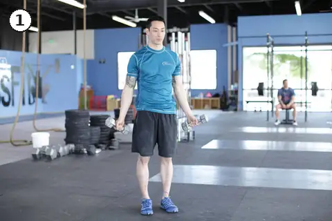

# Y-Heben im Stand (Scaption)

> Daumen nach oben, Arme schräg nach vorn (ca. 30°) bis Augenhöhe heben. Leicht, sauber.

- **Muskeln/Bereich:** Schultern, unterer Trapez
- **Equipment:** Kurzhanteln
- **Kategorie:** Schultern
- **Erfassung:** Gewicht und Wiederholungen, Steigerung 1 kg
- **Hantel:** zwei Kurzhanteln
