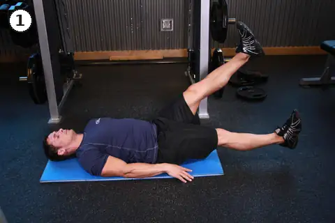

# Scherenschlag

> Rücken am Boden, gestreckte Beine knapp über dem Boden über Kreuz bewegen.

- **Muskeln/Bereich:** Unterer Bauch, Hüftbeuger
- **Equipment:** Körpergewicht
- **Kategorie:** Core
- **Erfassung:** Sekunden (Halten)
