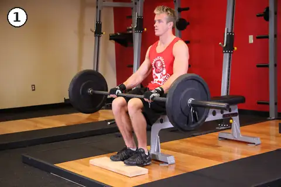

# Wadenheben sitzend

> Auf der Bankkante, Ballen auf einer Scheibe, Stange mit Polster auf den Oberschenkeln. Fersen tief, oben 1 s halten.

- **Muskeln/Bereich:** Waden (Schollenmuskel)
- **Equipment:** Langhantel, Bank
- **Kategorie:** Beine und Po
- **Erfassung:** Gewicht und Wiederholungen, Steigerung 2.5 kg
- **Hantel:** Langhantel
