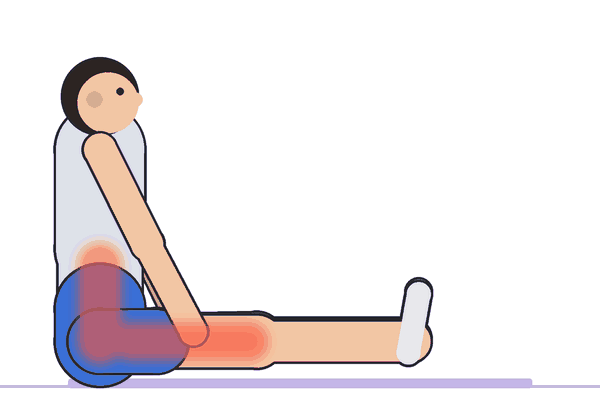

# Vorbeuge sitzend

> Beine lang, Füße aktiv. Erst den Rücken lang machen, dann aus der Hüfte nach vorn kippen. Knie dürfen leicht gebeugt sein.

- **Muskeln/Bereich:** Beinbeuger, Rücken
- **Equipment:** Körpergewicht
- **Kategorie:** Mobility
- **Erfassung:** Sekunden (Halten)

## Ausführung

- Sitzbeinhöcker spüren, ggf. auf ein gefaltetes Handtuch setzen.
- Erst wachsen: Scheitel nach oben, Rücken lang.
- Aus der Hüfte nach vorn kippen, Brust Richtung Knie, nicht Kopf Richtung Knie.
- Knie dürfen gebeugt bleiben, die Füße bleiben aktiv.

## Häufige Fehler

- Rund nach vorn ziehen und an den Füßen zerren.

## Atmung

Mit jedem Ausatmen ein kleines Stück tiefer.

## Wo du es spürst

Zug in den Oberschenkelrückseiten, nicht in der Kniekehle.

## Kommt vor in

- [Mobility nach Gefühl: Oberschenkel hinten](../mobility/koerperbereiche.md)
- [Yoga nach Gefühl](../mobility/yoga-baukasten.md)
