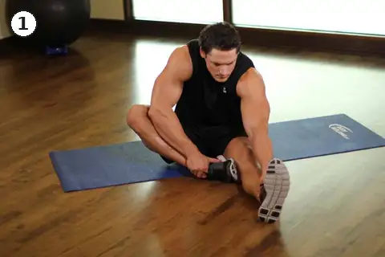

# Vorbeuge sitzend einbeinig

> Ein Bein lang, der andere Fuß am Oberschenkel, mit langem Rücken zum Fuß beugen.

- **Muskeln/Bereich:** Beinbeuger, Rücken
- **Equipment:** Körpergewicht
- **Kategorie:** Mobility
- **Erfassung:** Sekunden (Halten)

## Kommt vor in

- [Mobility nach Gefühl: Oberschenkel hinten](../mobility/koerperbereiche.md)
