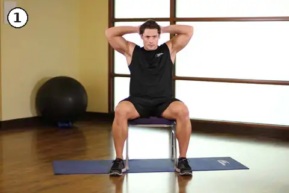

# Drehsitz

> Sitzend ein Bein über das andere stellen, mit langem Rücken zum aufgestellten Knie drehen.

- **Muskeln/Bereich:** Wirbelsäule, Po
- **Equipment:** Körpergewicht
- **Kategorie:** Mobility
- **Erfassung:** Sekunden (Halten)

## Kommt vor in

- [Mobility nach Gefühl: Oberer Rücken](../mobility/koerperbereiche.md)
- [Yoga nach Gefühl](../mobility/yoga-baukasten.md)
