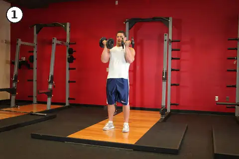

# Wechseldrücken (See-Saw)

> Eine Hantel hoch, eine runter, wechselnd drücken. Rumpf neigt sich leicht zur Gegenseite.

- **Muskeln/Bereich:** Schultern, Core seitlich
- **Equipment:** Kurzhanteln
- **Kategorie:** Schultern
- **Erfassung:** Gewicht und Wiederholungen, Steigerung 1 kg
- **Hantel:** zwei Kurzhanteln
