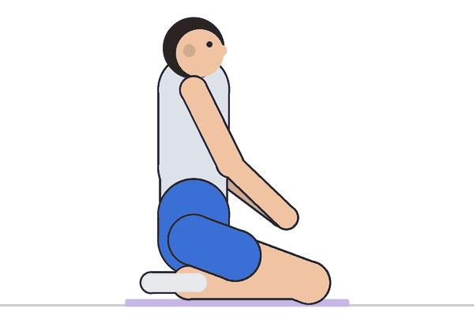

# Fersensitz

> Po auf den Fersen, Rücken lang, Hände auf den Oberschenkeln. Durch die Nase in den Bauch atmen.

- **Muskeln/Bereich:** Atmung, Ankommen
- **Equipment:** Körpergewicht
- **Kategorie:** Mobility
- **Erfassung:** Sekunden (Halten)

## Ausführung

- Knie zusammen, Po sinkt auf die Fersen. Ist es zu steil: Kissen zwischen Po und Fersen.
- Sitzbeinhöcker schwer, Scheitel wächst zur Decke.
- Kinn minimal einziehen, Nacken lang.
- Schultern sinken, Hände liegen locker auf den Oberschenkeln.

## Häufige Fehler

- Rundrücken oder bewusstes Hohlkreuz.
- Schmerz im Knie oder Spann aushalten: dann Unterlage nutzen.

## Atmung

Durch die Nase in den Bauch atmen. Ausatmen etwas länger als einatmen.

## Wo du es spürst

Ruhe, aufrechte Haltung ohne Anstrengung.

## Kommt vor in

- [Yoga-Flow · 20 min](../ablaeufe/gefuehrt/yoga20.md)
- [Yoga · 30 min](../ablaeufe/gefuehrt/yoga30.md)
- [Mobility nach Gefühl: Nacken](../mobility/koerperbereiche.md)
