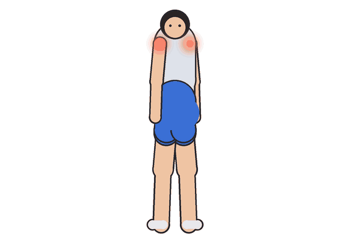

# Schulterkreisen

> Schultern hoch zu den Ohren, nach hinten und weit nach unten kreisen. Langsam und groß.

- **Muskeln/Bereich:** Nacken, Schultern
- **Equipment:** Körpergewicht
- **Kategorie:** Mobility
- **Erfassung:** Sekunden (Halten)

## Ausführung

- Aufrecht, Arme hängen locker.
- Schultern hoch zu den Ohren, dann weit nach hinten.
- Schulterblätter nach unten in die Gesäßtaschen ziehen.
- Große, langsame Kreise, der Kopf bleibt ruhig.

## Häufige Fehler

- Kleine, hastige Kreise.
- Den Kopf mitbewegen.

## Atmung

Einatmen beim Hochziehen, ausatmen beim Absenken.

## Wo du es spürst

Lockerheit in Nacken und Schultern.

## Kommt vor in

- [Mobility nach Gefühl: Nacken](../mobility/koerperbereiche.md)
- [Yoga nach Gefühl](../mobility/yoga-baukasten.md)
