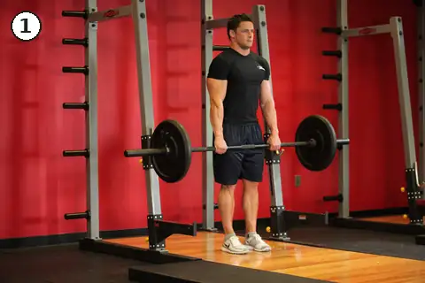

# Shrugs mit Langhantel

> Arme gestreckt, Schultern gerade nach oben zu den Ohren, oben 1 s halten. Nicht rollen.

- **Muskeln/Bereich:** Nacken, Trapez
- **Equipment:** Langhantel
- **Kategorie:** Schultern
- **Erfassung:** Gewicht und Wiederholungen, Steigerung 2.5 kg
- **Hantel:** Langhantel
