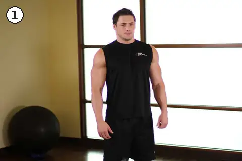

# Schulter-Dehnung vor dem Körper

> Arm vor dem Körper zur Gegenseite ziehen, Schulter bleibt tief.

- **Muskeln/Bereich:** Hintere Schulter
- **Equipment:** Körpergewicht
- **Kategorie:** Mobility
- **Erfassung:** Sekunden (Halten)

## Kommt vor in

- [Mobility nach Gefühl: Schultern und Brust](../mobility/koerperbereiche.md)
