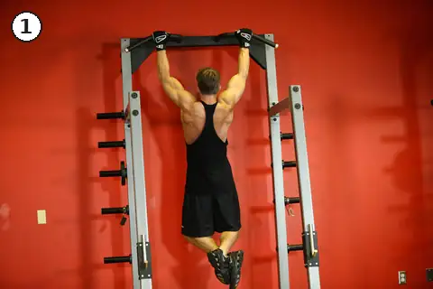

# Klimmzüge seitlich (Archer)

> Breit greifen, abwechselnd zu einer Hand hochziehen. Vorstufe zum einarmigen Klimmzug.

- **Muskeln/Bereich:** Rücken, Bizeps
- **Equipment:** Klimmzugstange, Calisthenics
- **Kategorie:** Rücken
- **Erfassung:** Körpergewicht, Wiederholungen
- **Braucht die Klimmzugstange**
