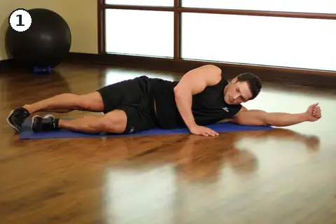

# Flanken-Dehnung liegend

> Seitlich liegend, oberen Arm lang über den Kopf strecken, Atem in die Flanke.

- **Muskeln/Bereich:** Flanke, Lat
- **Equipment:** Körpergewicht
- **Kategorie:** Mobility
- **Erfassung:** Sekunden (Halten)
