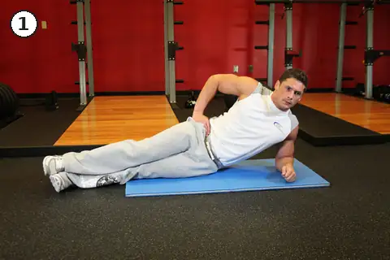

# Seitstütz

> Unterarm unter der Schulter, Körper eine Linie, Hüfte bleibt oben. Ersetzt das Suitcase Carry: gleiche seitliche Rumpfspannung, braucht keinen Platz.

- **Muskeln/Bereich:** Core (seitlich)
- **Equipment:** Körpergewicht
- **Kategorie:** Core
- **Erfassung:** Sekunden (Halten)
- **Pro Seite** ausführen

## Ausführung

- Ellbogen unter der Schulter, Unterarm nach vorn.
- Füße übereinander oder versetzt.
- Hüfte hoch, Körper eine gerade Linie.
- Obere Schulter leicht nach hinten, Brust offen.

## Häufige Fehler

- Hüfte sackt ab.
- Oberkörper kippt nach vorn.

## Atmung

Ruhig weiteratmen.

## Wo du es spürst

Seitlicher Bauch.

## Kommt vor in

- [Kraft B · Beine](../ablaeufe/kraft-b.md)
- [Vorlage Core Stabilität](../ablaeufe/vorlagen/x-core1.md)
- [Skill Einarmiger Liegestütz, Stufe 3](../skills/einarmliege.md)
