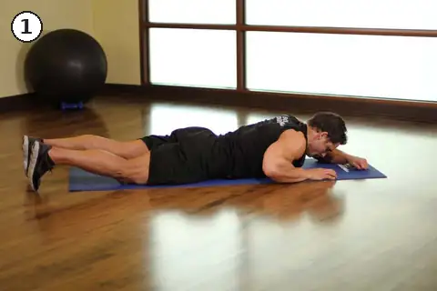

# Oberschenkel-Dehnung seitlich liegend

> Seitlich liegend den oberen Fuß zum Po ziehen, Hüfte nach vorn schieben.

- **Muskeln/Bereich:** Oberschenkel vorn, Hüftbeuger
- **Equipment:** Körpergewicht
- **Kategorie:** Mobility
- **Erfassung:** Sekunden (Halten)

## Kommt vor in

- [Mobility nach Gefühl: Hüfte und Hüftbeuger](../mobility/koerperbereiche.md)
