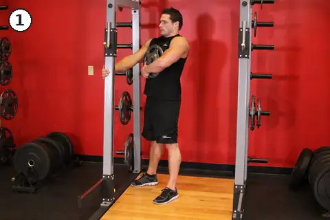

# Sissy Squat

> Auf den Ballen, Knie nach vorn schieben und Oberkörper nach hinten lehnen, Hüfte bleibt gestreckt.

- **Muskeln/Bereich:** Oberschenkel vorn
- **Equipment:** Körpergewicht, Calisthenics, Unkonventionell
- **Kategorie:** Beine und Po
- **Erfassung:** Körpergewicht, Wiederholungen

## Kommt vor in

- [Vorlage Calisthenics Beine](../ablaeufe/vorlagen/x-clegs.md)
