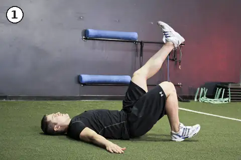

# Einbeinige Hüftbrücke

> Ein Bein angewinkelt, das andere gestreckt in der Luft. Hüfte hoch, oben halten. Schultern auf der Bank = schwerer.

- **Muskeln/Bereich:** Po, Beinbeuger
- **Equipment:** Körpergewicht, Bank
- **Kategorie:** Beine und Po
- **Erfassung:** Körpergewicht, Wiederholungen
- **Pro Seite** ausführen

## Kommt vor in

- [Vorlage Calisthenics Beine](../ablaeufe/vorlagen/x-clegs.md)
