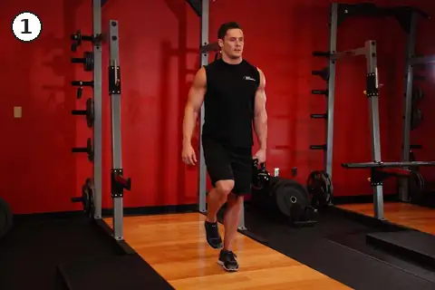

# Einbeiniges Kreuzheben

*Hinweis zum Foto: Foto mit Kettlebell, Ablauf mit Kurzhantel gleich.*

> Auf einem Bein, Hantel in der Gegenhand. Hüfte bleibt gerade, hinteres Bein bildet mit dem Rücken eine Linie.

- **Muskeln/Bereich:** Beinbeuger, Po, Balance
- **Equipment:** Kurzhanteln
- **Kategorie:** Beine und Po
- **Erfassung:** Gewicht und Wiederholungen, Steigerung 2 kg
- **Pro Seite** ausführen
