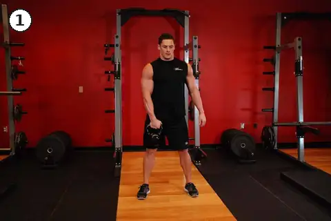

# Einarmiges Reißen

*Hinweis zum Foto: Foto mit Kettlebell, Ablauf mit Kurzhantel gleich.*

> Hantel zwischen den Füßen, explosiv aus der Hüfte in einem Zug über Kopf. Kontrolliert ablassen.

- **Muskeln/Bereich:** Ganzkörper, Schnellkraft
- **Equipment:** Kurzhanteln
- **Kategorie:** Ganzkörper
- **Erfassung:** Gewicht und Wiederholungen, Steigerung 2 kg
- **Pro Seite** ausführen
