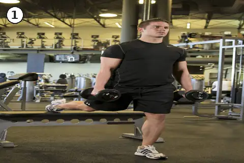

# Split Squat

> Schrittstellung bleibt stehen, senkrecht nach unten bis das hintere Knie fast den Boden berührt.

- **Muskeln/Bereich:** Oberschenkel, Po
- **Equipment:** Kurzhanteln
- **Kategorie:** Beine und Po
- **Erfassung:** Gewicht und Wiederholungen, Steigerung 1 kg
- **Hantel:** zwei Kurzhanteln
- **Pro Seite** ausführen
