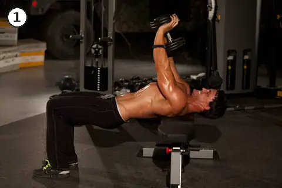

# Squeeze Press

> Hanteln fest gegeneinander pressen und so drücken. Spannung die ganze Zeit halten.

- **Muskeln/Bereich:** Brust innen, Trizeps
- **Equipment:** Kurzhanteln, Bank
- **Kategorie:** Brust
- **Erfassung:** Gewicht und Wiederholungen, Steigerung 1 kg
- **Hantel:** zwei Kurzhanteln

## Kommt vor in

- [Vorlage Oberkörper Drücken](../ablaeufe/vorlagen/x-push.md)
- [Skill Kurzhantel-Bankdrücken, Stufe 3](../skills/bankdr.md)
