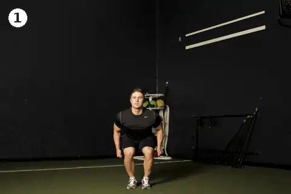

# Sternsprung

> Aus der leichten Hocke hochspringen und Arme und Beine zum Stern spreizen.

- **Muskeln/Bereich:** Ganzkörper, Kondition
- **Equipment:** Körpergewicht
- **Kategorie:** Kondition
- **Erfassung:** Sekunden (Halten)
