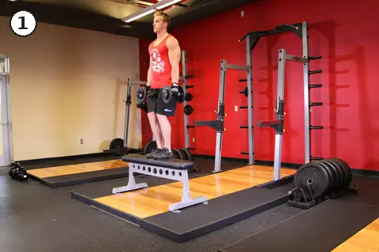

# Step-ups auf die Bank

> Ganzen Fuß auf die Bank, aus dem vorderen Bein hochdrücken, nicht mit dem hinteren abfedern. Bank an die Wand.

- **Muskeln/Bereich:** Oberschenkel, Po
- **Equipment:** Kurzhanteln, Bank
- **Kategorie:** Beine und Po
- **Erfassung:** Gewicht und Wiederholungen, Steigerung 1 kg
- **Hantel:** zwei Kurzhanteln
- **Pro Seite** ausführen

## Kommt vor in

- [Vorlage Beine und Po](../ablaeufe/vorlagen/x-legs.md)
