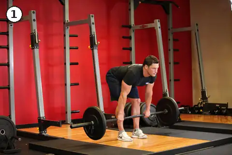

# Kreuzheben mit gestreckten Beinen

> Knie fast gestreckt, Rücken lang. Nur so tief, wie der Rücken gerade bleibt. Leichter als beim normalen Kreuzheben.

- **Muskeln/Bereich:** Beinbeuger, Po, unterer Rücken
- **Equipment:** Langhantel
- **Kategorie:** Beine und Po
- **Erfassung:** Gewicht und Wiederholungen, Steigerung 2.5 kg
- **Hantel:** Langhantel
