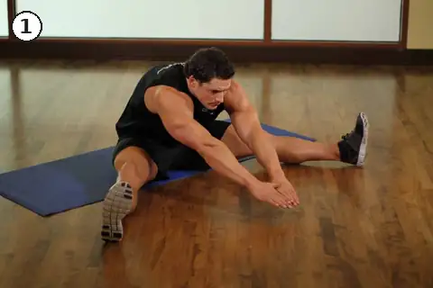

# Grätsche sitzend

> Beine weit gegrätscht, mit langem Rücken nach vorn neigen.

- **Muskeln/Bereich:** Oberschenkel innen, Beinbeuger
- **Equipment:** Körpergewicht
- **Kategorie:** Mobility
- **Erfassung:** Sekunden (Halten)

## Kommt vor in

- [Mobility nach Gefühl: Leiste und Innenseite](../mobility/koerperbereiche.md)
