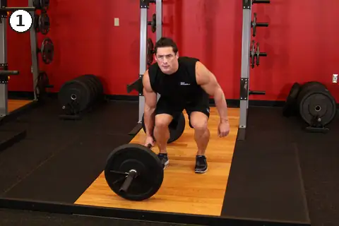

# Suitcase-Kreuzheben

> Stange einseitig in der Mitte greifen wie einen Koffer. Kreuzheben, ohne dass der Oberkörper zur Seite kippt. Seiten wechseln.

- **Muskeln/Bereich:** Core seitlich, Griff, Po
- **Equipment:** Langhantel, Unkonventionell
- **Kategorie:** Core
- **Erfassung:** Gewicht und Wiederholungen, Steigerung 2.5 kg
- **Hantel:** Langhantel
- **Pro Seite** ausführen

## Kommt vor in

- [Vorlage Langhantel kompakt](../ablaeufe/vorlagen/x-lh.md)
