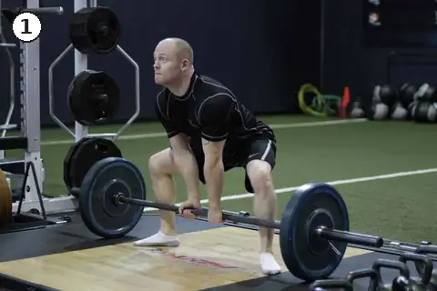

# Sumo-Kreuzheben

> Breiter Stand, Fußspitzen nach außen, Hände innen. Knie nach außen drücken, Brust hoch, Boden wegdrücken.

- **Muskeln/Bereich:** Po, Oberschenkel innen, Rücken
- **Equipment:** Langhantel
- **Kategorie:** Beine und Po
- **Erfassung:** Gewicht und Wiederholungen, Steigerung 2.5 kg
- **Hantel:** Langhantel
