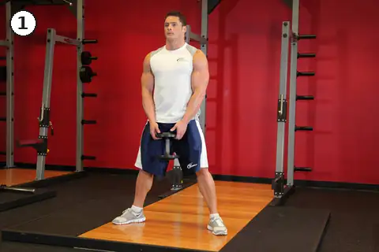

# Sumo-Kniebeuge mit Kurzhantel

> Breiter Stand, Hantel hängt zwischen den Beinen, Knie nach außen.

- **Muskeln/Bereich:** Oberschenkel, Po, Adduktoren
- **Equipment:** Kurzhanteln
- **Kategorie:** Beine und Po
- **Erfassung:** Gewicht und Wiederholungen, Steigerung 2 kg

## Kommt vor in

- [Skill Mittelspagat, Stufe 1](../skills/mittelspagat.md)
