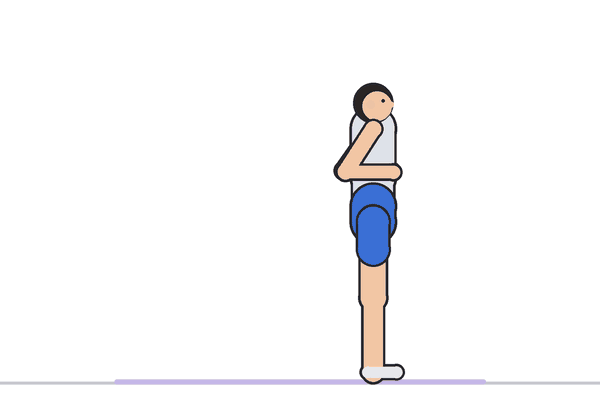

# Sonnengruß A

> Arme hoch, Vorbeuge, halbe Vorbeuge, Brett, tief, heraufschauender Hund, herabschauender Hund, nach vorn, aufrichten. Eine Bewegung pro Atemzug.

- **Muskeln/Bereich:** Ganzkörper
- **Equipment:** Körpergewicht
- **Kategorie:** Mobility
- **Erfassung:** Sekunden (Halten)

## Ausführung

- Berghaltung: Füße hüftbreit, Gewicht gleichmäßig, Arme mit dem Einatmen nach oben.
- Vorbeuge aus der Hüfte, Knie dürfen gebeugt sein, Rücken möglichst lang.
- Halbe Vorbeuge: Hände an die Schienbeine, Rücken flach, Blick nach vorn.
- Brett: Schultern über den Handgelenken, Körper eine Linie, dann kontrolliert absenken.
- Heraufschauender Hund: Hüfte tief, Brust nach vorn oben, Schultern weg von den Ohren.
- Herabschauender Hund: Hüfte nach hinten oben, 3 Atemzüge, dann nach vorn kommen.

## Häufige Fehler

- Atem anhalten oder hetzen.
- Beim Absenken die Ellbogen weit nach außen.
- Im Hund den Rücken rund ziehen, nur um die Fersen auf den Boden zu bekommen.

## Atmung

Eine Bewegung pro Atemzug: Arme hoch einatmen, vorbeugen ausatmen.

## Wo du es spürst

Wärme im ganzen Körper, Puls leicht erhöht.

## Kommt vor in

- [Yoga-Flow · 20 min](../ablaeufe/gefuehrt/yoga20.md)
- [Yoga · 30 min](../ablaeufe/gefuehrt/yoga30.md)
