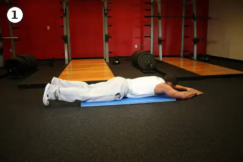

# Superman

> Bauchlage, Arme und Beine gleichzeitig leicht anheben und halten. Blick zum Boden.

- **Muskeln/Bereich:** Unterer Rücken, Po
- **Equipment:** Körpergewicht
- **Kategorie:** Rücken
- **Erfassung:** Sekunden (Halten)

## Kommt vor in

- [Vorlage Core-Zirkel 20 min](../ablaeufe/vorlagen/x-core3.md)
