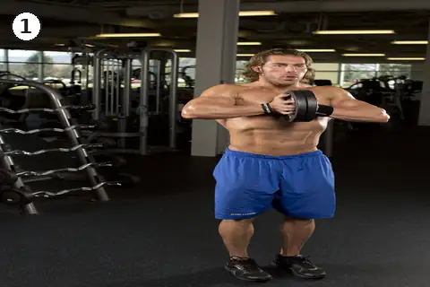

# Svend Press

> Scheibe zwischen den Handflächen pressen und vor der Brust nach vorn strecken. Druck die ganze Zeit halten.

- **Muskeln/Bereich:** Brust innen
- **Equipment:** Unkonventionell
- **Kategorie:** Brust
- **Erfassung:** Gewicht und Wiederholungen, Steigerung 1.25 kg
