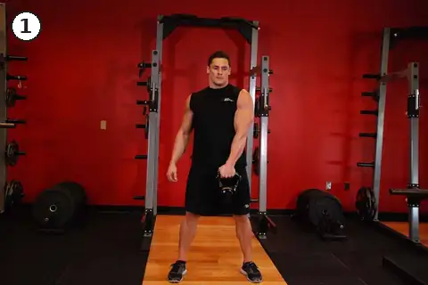

# Kurzhantel-Swing

*Hinweis zum Foto: Foto mit Kettlebell, Ablauf mit Kurzhantel gleich.*

> Hantel am Ende mit beiden Händen. Aus der Hüfte schwingen, nicht aus den Armen. Oben Po fest.

- **Muskeln/Bereich:** Po, Beinbeuger, Kondition
- **Equipment:** Kurzhanteln
- **Kategorie:** Ganzkörper
- **Erfassung:** Gewicht und Wiederholungen, Steigerung 2 kg

## Kommt vor in

- [Vorlage Kurzhantel-Kondition](../ablaeufe/vorlagen/x-dbcond.md)
