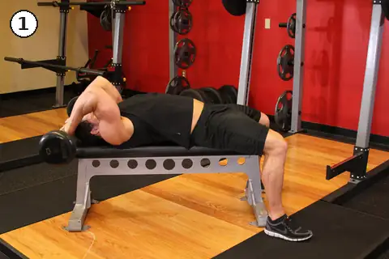

# French Press hinter den Kopf

> Auf der Bank liegend Stange hinter den Kopf absenken, Oberarme leicht nach hinten geneigt. Mehr Dehnung als klassisches French Press.

- **Muskeln/Bereich:** Trizeps (langer Kopf)
- **Equipment:** SZ-Stange, Bank
- **Kategorie:** Arme
- **Erfassung:** Gewicht und Wiederholungen, Steigerung 2.5 kg
- **Hantel:** SZ-Stange
