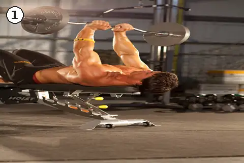

# Enges Bodendrücken

> Am Boden liegend, enger Griff, Ellbogen nah am Körper. Trifft vor allem den Trizeps.

- **Muskeln/Bereich:** Trizeps, Brust
- **Equipment:** SZ-Stange
- **Kategorie:** Arme
- **Erfassung:** Gewicht und Wiederholungen, Steigerung 2.5 kg
- **Hantel:** SZ-Stange
