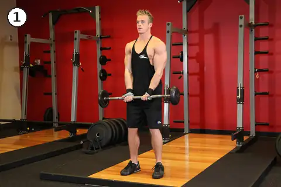

# Curls enger Griff

> Enger Griff an der inneren Biegung, Ellbogen bleiben am Körper.

- **Muskeln/Bereich:** Bizeps (langer Kopf)
- **Equipment:** SZ-Stange
- **Kategorie:** Arme
- **Erfassung:** Gewicht und Wiederholungen, Steigerung 2.5 kg
- **Hantel:** SZ-Stange
