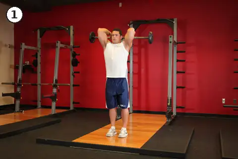

# Überkopf-Trizepsdrücken

> Aufrecht auf der Bank sitzen, Stange hinter dem Kopf absenken, Ellbogen zeigen nach vorn oben.

- **Muskeln/Bereich:** Trizeps (langer Kopf)
- **Equipment:** SZ-Stange, Bank
- **Kategorie:** Arme
- **Erfassung:** Gewicht und Wiederholungen, Steigerung 2.5 kg
- **Hantel:** SZ-Stange
