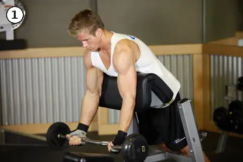

# Spider Curls auf der Bank

> Bäuchlings auf der Bank, Arme hängen senkrecht. Ohne Schwung bis oben curlen, unten ganz strecken.

- **Muskeln/Bereich:** Bizeps
- **Equipment:** SZ-Stange, Bank
- **Kategorie:** Arme
- **Erfassung:** Gewicht und Wiederholungen, Steigerung 2.5 kg
- **Hantel:** SZ-Stange
