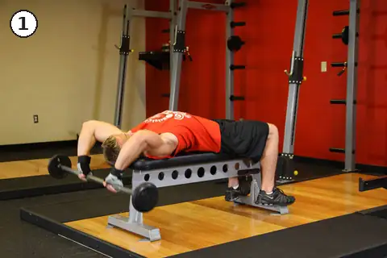

# Überzüge mit SZ-Stange

> Auf der Bank liegend, Arme leicht gebeugt, Stange hinter den Kopf bis zur Dehnung im Lat absenken.

- **Muskeln/Bereich:** Lat, Brust
- **Equipment:** SZ-Stange, Bank
- **Kategorie:** Rücken
- **Erfassung:** Gewicht und Wiederholungen, Steigerung 2.5 kg
- **Hantel:** SZ-Stange
