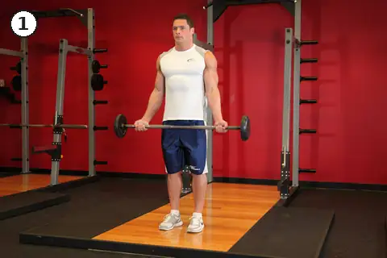

# Curls weiter Griff

> Griff etwas breiter als die Schultern, Ellbogen am Körper, kein Schwung.

- **Muskeln/Bereich:** Bizeps (kurzer Kopf)
- **Equipment:** SZ-Stange
- **Kategorie:** Arme
- **Erfassung:** Gewicht und Wiederholungen, Steigerung 2.5 kg
- **Hantel:** SZ-Stange
