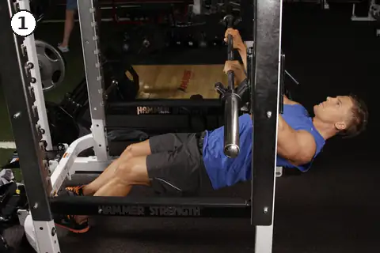

# Rudern unter dem Tisch

*Hinweis zum Foto: Foto an einer Stange im Rack, unter einem stabilen Tisch gleich.*

> Unter einen stabilen Tisch legen, Kante greifen, Körper gerade zur Kante ziehen. Vorher prüfen, dass der Tisch nicht kippen kann.

- **Muskeln/Bereich:** Rücken, Bizeps
- **Equipment:** Calisthenics, Unkonventionell
- **Kategorie:** Rücken
- **Erfassung:** Körpergewicht, Wiederholungen
