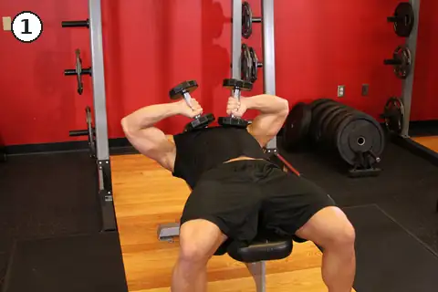

# Tate Press

> Hanteln über der Brust, Ellbogen nach außen, Hanteln zur Brust kippen und wieder strecken.

- **Muskeln/Bereich:** Trizeps
- **Equipment:** Kurzhanteln, Bank
- **Kategorie:** Arme
- **Erfassung:** Gewicht und Wiederholungen, Steigerung 1 kg
- **Hantel:** zwei Kurzhanteln

## Kommt vor in

- [Vorlage Oberkörper Drücken](../ablaeufe/vorlagen/x-push.md)
