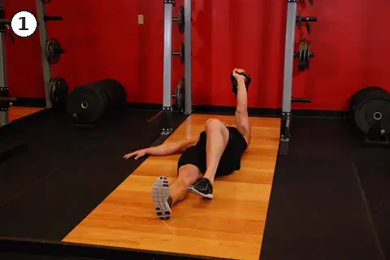

# Turkish Get-up

*Hinweis zum Foto: Foto mit Kettlebell, Ablauf mit Kurzhantel gleich.*

> Mit gestreckter Hantel über Kopf aus dem Liegen Schritt für Schritt in den Stand und zurück. Blick zur Hantel. Erst ohne Gewicht üben.

- **Muskeln/Bereich:** Ganzkörper, Schultern, Core
- **Equipment:** Kurzhanteln, Unkonventionell
- **Kategorie:** Ganzkörper
- **Erfassung:** Gewicht und Wiederholungen, Steigerung 2 kg
- **Pro Seite** ausführen

## Kommt vor in

- [Vorlage Landmine und Unkonventionell](../ablaeufe/vorlagen/x-land.md)
- [Skill Turkish Get-up, Stufe 1](../skills/tgu.md)
- [Skill Turkish Get-up, Stufe 2](../skills/tgu.md)
- [Skill Turkish Get-up, Stufe 3](../skills/tgu.md)
- [Skill Turkish Get-up, Stufe 4](../skills/tgu.md)
- [Skill Turkish Get-up, Stufe 5](../skills/tgu.md)
