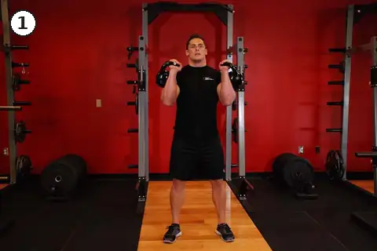

# Thruster mit Kurzhanteln

*Hinweis zum Foto: Foto mit Kettlebell, Ablauf mit Kurzhantel gleich.*

> Aus tiefer Hocke explosiv hochdrücken, erst Beine, dann Arme.

- **Muskeln/Bereich:** Ganzkörper
- **Equipment:** Kurzhanteln
- **Kategorie:** Ganzkörper
- **Erfassung:** Sekunden (Halten)

## Ausführung

- Hanteln auf den Schultern.
- Tiefe Hocke, Knie folgen den Zehen.
- Explosiv hochkommen und den Schwung in den Druck mitnehmen.

## Häufige Fehler

- Erst stehen, dann drücken: Schwung geht verloren.

## Atmung

Ausatmen beim Drücken.

## Wo du es spürst

Ganzkörper.

## Kommt vor in

- [Vorlage Kurzhantel-Kondition](../ablaeufe/vorlagen/x-dbcond.md)
- [Kondition + Core-Zirkel](../ablaeufe/gefuehrt/circuit.md)
