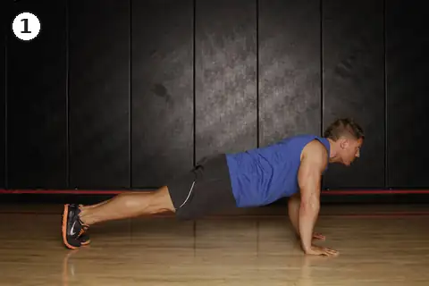

# T-Liegestütze

> Nach jeder Liegestütze in den Seitstütz aufdrehen, Arm zur Decke. Seiten abwechseln.

- **Muskeln/Bereich:** Brust, Core seitlich
- **Equipment:** Liegestützbrett, Körpergewicht
- **Kategorie:** Core
- **Erfassung:** Körpergewicht, Wiederholungen
