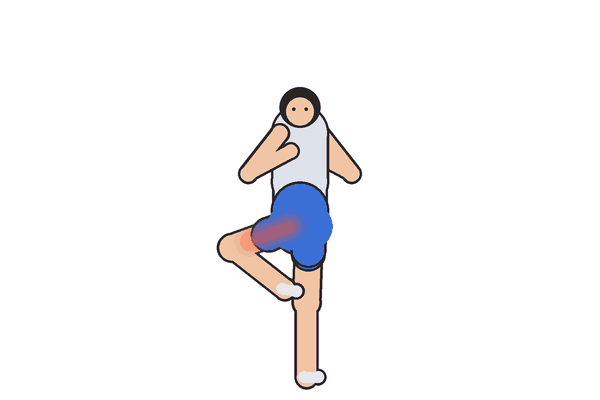

# Baum

> Fuß an die Innenseite von Wade oder Oberschenkel (nicht aufs Knie). Knie zeigt zur Seite, Blick auf einen festen Punkt, Hände vor der Brust oder nach oben.

- **Muskeln/Bereich:** Gleichgewicht, Hüfte, Fußgewölbe
- **Equipment:** Körpergewicht
- **Kategorie:** Mobility
- **Erfassung:** Sekunden (Halten)

## Ausführung

- Gewicht auf ein Bein, ganzer Fuß verwurzelt.
- Fuß an Wade oder Oberschenkel, nicht aufs Knie.
- Fuß und Bein drücken gegeneinander, Becken bleibt gerade.
- Blick auf einen festen Punkt, Hände vor der Brust oder nach oben.

## Häufige Fehler

- Hüfte schiebt zur Seite des Standbeins.
- Fuß drückt gegen das Knie.

## Atmung

Ruhig atmen hilft beim Gleichgewicht.

## Wo du es spürst

Arbeit im Standfuß und in der Hüfte, Öffnung im angewinkelten Bein.

## Kommt vor in

- [Yoga nach Gefühl](../mobility/yoga-baukasten.md)
