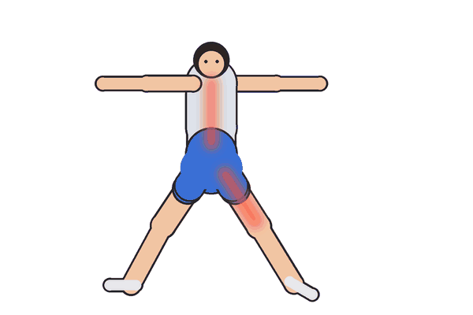

# Dreieck

> Breiter Stand, vorderer Fuß nach außen. Hüfte nach hinten schieben, Oberkörper seitlich über das vordere Bein, untere Hand ans Schienbein, obere Hand zur Decke.

- **Muskeln/Bereich:** Beinbeuger, Leiste, Flanke
- **Equipment:** Körpergewicht
- **Kategorie:** Mobility
- **Erfassung:** Sekunden (Halten)

## Ausführung

- Breiter Stand, vorderer Fuß zeigt nach außen, hinterer leicht nach innen.
- Beide Beine gestreckt, aber Knie nicht durchdrücken.
- Hüfte nach hinten schieben, Oberkörper kippt seitlich über das vordere Bein.
- Untere Hand ans Schienbein oder einen Block, obere Hand zur Decke, Brust öffnet sich.

## Häufige Fehler

- Oberkörper kippt nach vorn statt zur Seite.
- Hand drückt aufs Knie.

## Atmung

Einatmen lang machen, ausatmen tiefer sinken.

## Wo du es spürst

Dehnung in der Beinrückseite und der Flanke.

## Kommt vor in

- [Yoga nach Gefühl](../mobility/yoga-baukasten.md)
