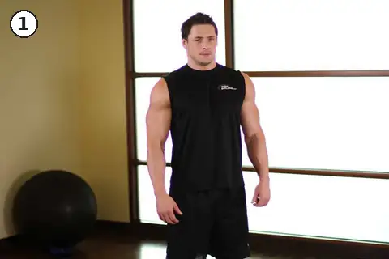

# Trizeps-Dehnung

> Hand hinter den Kopf zwischen die Schulterblätter, Ellbogen sanft mit der anderen Hand ziehen.

- **Muskeln/Bereich:** Trizeps, Schulter
- **Equipment:** Körpergewicht
- **Kategorie:** Mobility
- **Erfassung:** Sekunden (Halten)

## Kommt vor in

- [Mobility nach Gefühl: Schultern und Brust](../mobility/koerperbereiche.md)
